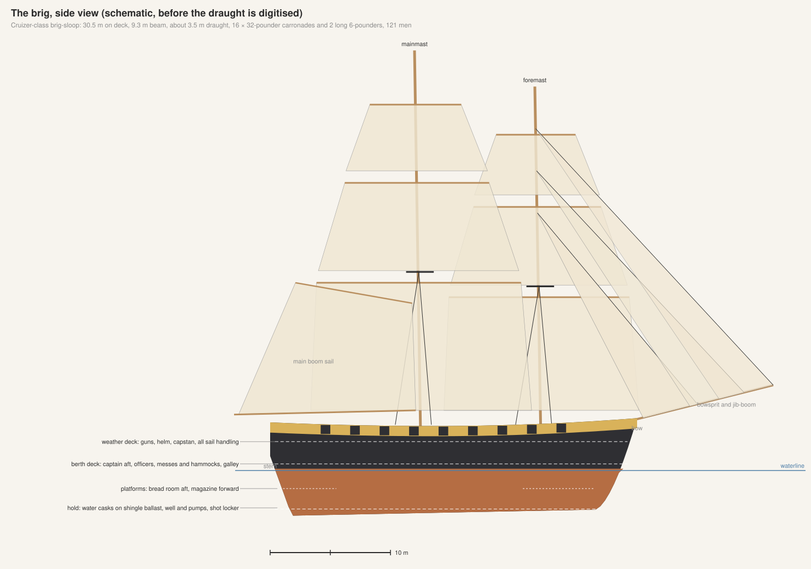
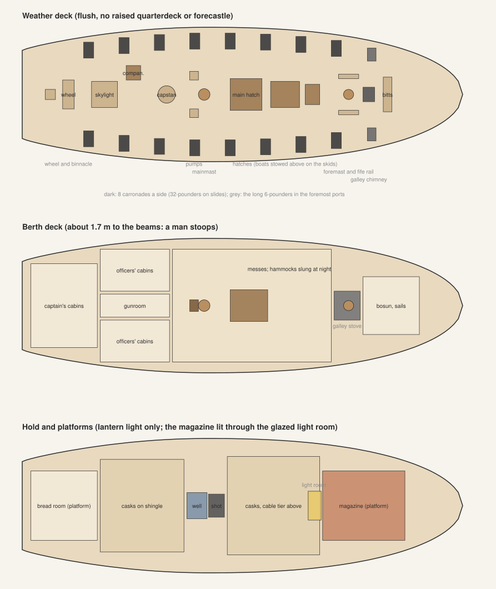

# Nauta: the brig

**Status: proposal**, written 2026-11-17 by the ship thread for Arnd to agree. It works out what [nauta-plan.md](nauta-plan.md) calls "a brig detailed enough to live on for twenty minutes" and answers the open questions of N2 in [implementation-plan.md](implementation-plan.md). Where it would change the plan, the section "What this changes in the plan" at the end says so; those changes go to the design thread and are not made here.

Both drawings are schematic: the right proportions and the right things in the right places, drawn before the real lines are taken off the draught (see "How she is made").

## What MasterWorld gives, and what it does not

MasterWorld's ships (`@futuremagic/settlement` `planShip`, `shipMesh`; MasterWorld `src/world/deck.ts`, `src/render/ships.ts`) are a harbour merchantman: a hull from a formula, raised castles fore and aft, two decks, one ladder down, flat sails, a few dozen ropes, vertex colours. They were made to be passed on a quay. Nauta's brig is lived on for twenty minutes and shot to pieces, so almost nothing of that carries over. What does:

- **The ship's frame and the carried walker:** a pose (position, heading, pitch, roll), `toWorld` and `toShip`, and a body that stands on a moving deck and goes with it. N2.3 already moves this into a shared package.
- **Floors as a question to the plan** (`shipFloors`: every floor under a point, lowest first) and walls as a question (`shipWall`). The idea is right; the plan behind it is new.
- **Climbing a ladder with hands and feet** (`@futuremagic/figure` `LadderClimb`).
- **Cutting the sea out of the hull** by the hull's half widths at stations along the waterline (`render/ships.ts` `waterline`), as a starting idea for N2.5.

What is new: the hull form, the structure, the decks below, the rig, the sails, the guns, the stations, the damage, and the level of detail.

## The ship

**She is a Cruizer-class brig-sloop** of the Royal Navy, the most built warship design of the age (over a hundred from 1797, fought all through the Napoleonic wars and in 1812), and the brig the plan already describes: about 30 m on deck, a crew of about 120, guns on one open deck. Her French opposite is the Abeille-class *brick* of the same years, the same size and layout.

| | |
| --- | --- |
| Length on the gun deck | 30.5 m (100 ft); keel 23.5 m |
| Beam | 9.3 m (30 ft 6 in) |
| Depth of hold | 3.9 m (12 ft 9 in) |
| Draught | about 3.5 m, deeper aft; fixed from the draught |
| Weight afloat | about 450 to 500 t, fixed from the lines (N2.1's 3 % test) |
| Burthen | 382 tons |
| Crew | 121 officers, men and boys |
| Guns | 16 × 32-pounder carronades on slides, 8 a side; 2 × long 6-pounders in the foremost ports, shifted to the bow as chasers |
| Rig | brig: two square-rigged masts, a fore-and-aft main boom sail, headsails on a bowsprit and jib-boom |
| Sails | fore and main course, topsail, topgallant (6 square sails); main boom sail; fore topmast staysail, jib, flying jib; two staysails between the masts. 11 in all. No studding sails or royals in the first game |
| Masts | main truck about 32 m and fore about 29 m over the deck; lower masts about 20 m; main yard about 17 m. The spar table from Steel's rules (1794) for brigs, checked against the Admiralty's sail plan for 18-gun brigs |
| Boats | a cutter and a jolly boat on the skids amidships, a gig at the stern davits |
| Looks, British | black hull, a yellow ochre band along the ports, black port lids red inside, red ochre inside the bulwarks, copper below the water, scrubbed pale deck, black yards, oiled masts, a plain figurehead |
| Looks, French | black hull with a narrow red or ochre band, red inside, a different figurehead and stern, the tricolour |

**Both navies sail the same hull in the first game.** A duel between equal ships is fair and teaches that seamanship wins. The navies differ in paint, flag, figurehead, crew dress and the bubbles' phrases. Two different historical brigs (the French one lighter armed) can come later as a choice.

**The carronades decide how she fights.** A 32-pounder carronade smashes a brig's side at close range and is poor beyond about 400 m; the long sixes reach far but hit lightly. So a duel is won by closing, by the weather gauge and by raking, which is the close, violent fight the game wants. Ranges are tuned for pace in N5, not changed in kind.

## Where you can go

All of her, from the hold to the tops of the masts for the crew, and every deck for the captain. She is flush-decked: no raised quarterdeck or forecastle, one open deck from bow to stern with the guns along both sides. The "quarterdeck" is the after part of it, where the captain stands.

**The weather deck** is where the fight is. From aft: the ensign, the wheel and binnacle with the helmsmen and the master; the skylight over the captain's cabin; the companion down; the capstan; the pumps either side of the mainmast; the main hatch under the boats on their skids; the fore hatch; the foremast with its fife rail and belaying pins; the galley chimney; the bitts and the heel of the bowsprit; the catheads with the anchors. Eight carronades and a long six each side, the hammock nettings along the rails, shot in garlands by every gun, the lines coiled on their pins.

**The berth deck** is the ship's house, about 1.7 m to the underside of the beams, so men stoop and the captain does too. Aft the captain's cabins (lit by the skylight), then the gunroom and the officers' small cabins, then the long open messdeck where the men eat at tables slung from the beams and sleep in hammocks at night; the galley stove forward, the boatswain's and sail stores in the bow. In battle the surgeon works aft here, and the wounded are carried down to him.

**The platforms and the hold** are seen by lantern. Forward the magazine, where powder is filled into cartridges and passed up by the boys, lit only through the glazed light room beside it; aft the bread room. Amidships the well, where the pumps draw and the carpenter sounds the water; the shot locker; the water casks on shingle ballast; the cable tier. This is where flooding is first seen and where a fire becomes deadly.

**Aloft** the tops of both masts, the yards with their footropes and the shrouds with their ratlines, where the topmen work. Whether the captain may climb to the maintop with his glass is a question below.

**Where orders are given.** Every order is given to a person at a place, which the plan names (N4.4 builds the menu on them):

| Station | Who | Orders |
| --- | --- | --- |
| The wheel | the master and the helmsmen | course, come up, bear away, tack, wear, heave to |
| The quarterdeck, by the capstan | the first lieutenant, the boatswain beside him with his pipe | sail: battle sail, plain sail, make or take in, reef, brace |
| The waist, among the guns | the second lieutenant or the gunner, gun captains | quarters, shot, target, run out, fire, cease fire, which side |
| The fore hatch, the magazine below | the gunner's mate, the powder boys | what is filled and passed up |
| The well and the pumps | the carpenter | sound the well, man the pumps, plug and patch |
| The tops and the masthead | the lookouts, marines in action | report a sail, fire at her deck |
| The berth deck aft | the surgeon | (reports only) |

## How much detail

Detail follows what the captain can touch, what he sees on board, and what he sees of the other ship. Three rings:

| Ring | What | How it is drawn |
| --- | --- | --- |
| **Within reach** (0 to 3 m) | Rails, gun and carriage, breeching and tackle, belaying pins and the coils on them, the wheel, the binnacle, ladders and hatch coamings, gratings, the deck under his feet | Real thickness and bevelled edges, baked normal maps (AssetGenerator), wood grain that runs along the plank, worn paint on edges, tar at the seams, rope with a visible lay. About 1 texel a millimetre |
| **On board** (3 to 40 m) | The rest of the hull and deck, masts, yards, tops, every rope, every sail | Every part that exists on her is there, with the right silhouette and the right motion. Planks, seams and ironwork from shared tiling materials in ship space. Ropes drawn so they never shimmer |
| **The other ship** (50 m to the horizon) | Her whole outside | Levels of detail by distance that never pop: full rig to 300 m, the main lines only to 1 km, then sails and spars. Her sails, damage, smoke and flags are always her own, never a stand-in |

**The details that make it feel real**, which get the most care because the "being there" list in the design comes from them:

1. **The rigging around you.** Shrouds and ratlines rising past you, lines running through blocks to the pins, everything moving as she rolls. About 200 lines, 40 shrouds with their deadeyes, 450 ratlines, 150 blocks. This, more than the hull, is what says "sailing warship" from her deck.
2. **The shadows of the rig** sweeping over the deck and the sails with the roll, and sunlight falling through the gratings onto the berth deck below.
3. **Sails that behave.** They fill and press, shiver when she comes up too far, slam aback, are seen being set and furled by men on the yards, and glow when the sun is behind them, showing their seams and the rig's shadows.
4. **The low, dark berth deck,** beams close over your head, lanterns swinging, light through the hatches, hammocks.
5. **Weight.** A gun is heavy iron on a heavy slide, a mast is a tree, the deck is thick planking on beams you can see from below. Nothing is thin or toy-like.
6. **Use and wear.** The deck scrubbed pale but stained at the guns, tar, rust streaks from the chainplates, rope worn where it chafes.

**Left out on purpose:** carved stern galleries (a brig has none), studding sails and royals, the anchors at work, boats in the water, a furnished interior in every officer's cabin (their doors stay closed), and the deep hold beyond lantern light.

## Masts, rigging and sails

**Spars** are turned in code from the spar table: masts with their tops, caps and trestle trees, yards with their slings, footropes and stirrups, the bowsprit and jib-boom, the boom and gaff. Each spar is a chain of segments (lower mast, topmast, topgallant), so a hit breaks it at a real place.

**Every rope is a real line** between two real points: a deadeye, a block, a pin, a cleat, a yard arm. The plan (with N3.2's rig plan) lists each line, what it is (shroud, stay, brace, sheet, clewline, halliard), where it is made fast and what it does, so the sailing model, the crew (who haul at its pin), the damage (which cuts it) and the drawing all read the same list. A line is drawn by its sag: taut lines nearly straight, slack ones hanging, a cut one falling away. Ropes are one material kind drawn in a few calls: as round tubes near, as flat strips far, never thinner than a pixel and fading by how much of a pixel they cover, so the rig never flickers into a shimmer (the known weakness of thin lines on a tablet).

**Sails** are not a cloth simulation. The simulation says how each sail stands (how far it is set, reefs, the brace angle, how hard the wind presses it, whether it is aback or shivering); the drawing shapes a fine grid from that: corners at the yard arms and clews, a belly by the pressure, ripples running along a shivering sail, the gathered folds of a sail being clewed up. Seams every 0.6 m, reef bands and reef points, bolt ropes, light through the canvas. A sail has its own hole map, so every shot through it stays, and it can split along a seam and flog. A full cloth simulation can be a desktop quality level later; it is not needed for the look.

**Flags:** the ensign at the gaff in action, the pennant at the main truck. Simple cloth that shows the true wind exactly, since the captain reads the wind from them.

## Guns

Each carronade on its slide and each long six on its truck carriage is a hero fitting in the "within reach" ring, with its breeching rope, side tackles, train tackle, sponge, rammer, handspike, match tub and shot garland. The drill moves real parts: the port lid swings up, the gun runs out on its tackles, leaps back on its breeching, the slide's compressor bites. The gun crews' places around each gun are in the plan, so N4 and N5 stand the men where a crew stood.

## What can be damaged, and how it shows

The plan divides everything that can be hit into numbered cells (N2.1). The simulation decides what happens to each cell (N6.1); this table is what the drawing must be ready for from the first hull it builds.

| Part | States | How it shows |
| --- | --- | --- |
| Hull side, each panel of planking (about 1 m by 1 m) | sound, holed (holes listed), stove in | Every hole is cut where the ball went, inside and out, with splintered edges and the light through it; a stove-in panel opens to the frames. Holes are drawn from a damage map over the hull, so there can be hundreds without more geometry |
| Bulwark and rail, each section between two timberheads | sound, holed, smashed out | Smashed sections are swapped for broken pieces with jagged plank ends; splinters fly |
| Deck, each panel | sound, holed, scorched, stained | Holes from plunging shot, burn marks, blood at the stronger violence levels |
| Gun | ready, dismounted, slide broken | The barrel lies on the deck off its slide |
| Port lid, hatch, grating, skylight | sound, broken, gone | Swapped pieces |
| Masts, yards, bowsprit, each segment | sound, wounded, broken | Wounded: splintered, fished with lashings by the carpenter. Broken: the spar above the break falls with its sails and rigging, lies across the deck or drags alongside |
| Each line | sound, cut | A cut line falls slack; a cut brace lets its yard swing |
| Each sail | holes, split | Holes stay; a split sail flogs in two halves |
| Wheel, tiller ropes | sound, shot away | Steering by the relieving tackles below (a crew task) |
| Boats | sound, smashed | Splinters, then wreckage |
| Fire | where it burns | Flames, smoke and charring on planking, sails and rigging |
| Water in her | its level and its slope | A water surface inside the hold and then the berth deck, sloshing with her roll (the one water drawn inside the hull) |

## How she is made

**One plan, five uses.** The brig is data (`src/sim/ship/plan.ts`, numbers in `src/sim/rules/ships.ts`), built in code, as the plan already says. From that one plan come: the hull's pressure points for floating (N2.2), the floors, walls, ladders and headroom you walk (N2.3), the places where men stand, haul, climb and fight, which become the crew's route graph (N4.2), the damage cells (N6.1), and the drawn ship (N2.4). Nothing about her shape is written twice.

**The hull form comes from her lines, not from a formula.** The Cruizer draughts (National Maritime Museum, Greenwich) are taken off as a table of offsets: the half breadth at each of about fifteen stations along her and eight heights, the keel, stem and sternpost profile, and the sheer of each deck. A smooth surface is fitted through them. That gives her real tumblehome, her full bow, her fine run aft and her real displacement, which no formula would.

**What is built in code, and what comes from the stack:**

| Piece | Made by | Where |
| --- | --- | --- |
| Hull surface, planking strakes with their butts, wales, copper, gunports, bulwarks and timberheads, channels | built from the plan, in a worker at load | Nauta `src/render/ship/` |
| Decks with their planks, beams, knees and carlings below, hatches and coamings, ladders, bulkheads and cabins | built from the plan | Nauta |
| Masts, yards, tops, bowsprit, boom and gaff | turned from the spar table | Nauta |
| Rigging and sails | from the rig plan (N3.2), drawn by the rope and sail kinds | Nauta |
| Guns and carriages, blocks, deadeyes, pins, cleats, wheel, binnacle, capstan, pumps, galley stove, bell, lanterns, boats, anchors, casks, buckets, cartridge boxes, rammers and sponges, hammocks, mess tables, chests | `prop.assembly` and `organic.sculpt` specs with their QA gates, textures and levels of detail | AssetGenerator, specs in `assets/specs/` |
| Wood, paint, copper, iron, tarred and hemp rope, canvas | shared tiling materials laid in ship space, so a plank's grain runs along the plank | AssetGenerator materials or `@futuremagic/texgen`, kinds in `src/render/materials.ts` |
| The crew and the captain's own body | Actors, with a new age-of-sail navy wardrobe | Actors |
| Climbing ladders and shrouds, hands on rails and lines | `@futuremagic/figure` | AssetGenerator |
| Look references before building (the deck at quarters at dusk, the berth deck by lantern) | image models | the openrouter skill |

The fittings near the captain (guns, wheel, binnacle, capstan) ship as models with baked textures and normal maps and their levels of detail. Small parts repeated hundreds of times (blocks, deadeyes, pins, coils) are packed and drawn as instances, their surfaces from the shared materials.

**Light.** The sun casts the shadows of her rig and hull from one shadow map of her own, fitted round her and moving with her, so the rigging's shadows are sharp on deck. Below deck the light is what really reaches it: through hatches, gratings, the skylight and holes, plus lanterns that swing with her. The eye adapts going down a ladder and coming up (the shared light rig, N1.5).

**Rooms and openings.** The plan knows her compartments and the openings between them (hatches, the companion, doors, holes shot in her). From the deck only what can be seen through an opening is drawn below, and from below the same; this keeps the berth deck, the hold and the men in them out of the frame when they cannot be seen.

**References** for taking her off and checking her look: the Admiralty draughts of the Cruizer class and the sail plan of 18-gun brigs (National Maritime Museum, used for measurements only), Steel's *Elements and Practice of Rigging and Seamanship* (1794, public domain), Lees' *Masting and Rigging of English Ships of War*, and the sailing brig *Niagara* (a working replica of an 1813 brig of the same size) for how a brig's deck, rig and crew look in use.

## Budgets on the iPad

Proposed for the budget table at gate G1, as a share of the existing frame:

| Budget | Proposal |
| --- | --- |
| Both ships drawn (hull, fittings, rigging, sails, damage) | at most 3 ms of a frame |
| Draw calls for both ships | at most 250 |
| Triangles drawn for both ships | at most 1.5 million |
| Ship memory (geometry, textures, damage maps) | at most 250 MB of the 1.2 GB |
| Ship download (models and textures, both navies) | at most 20 MB of the 60 MB |
| Building her at load, in a worker | at most 3 s of the 15 s from tap to deck |

**A warning for the design thread:** at the worst moment (a broadside in smoke, both crews in sight) sea 5 ms, crew 5 ms, ship 3 ms and smoke 3 ms already make 16 ms of the 16.7 ms frame, before the sky, the light and the interface. The budgets do not fit together at that moment and need balancing before G1 (for example smoke drawn at lower resolution, or the crew below decks drawn only through openings, which this design gives).

## Order of work

**First a slice, then the ship.** Before the whole brig is built, one 6 m section of her waist is built to the full quality wanted: deck and beams, bulwark with two carronades in their ports, the main shrouds with deadeyes and channel, the pin rail with coiled lines, a hatch with its grating and the berth deck below it, a lantern, in the real sea under the real sky. Arnd judges it on the iPad. That fixes the quality bar, the materials, the rope look and the cost per metre of ship before effort goes into 30 m of her, and anything that does not convince is found when it is cheap to change.

Then the plan's order holds: the plan (N2.1), floating, drawing and fittings side by side, walking, the water, the body and the sound.

## What this changes in the plan

For the design thread to take into [implementation-plan.md](implementation-plan.md) and [nauta-plan.md](nauta-plan.md), once Arnd agrees:

1. **N2's open question "the brig's sheet"** is answered by the sheet above: a Cruizer-class brig-sloop, the same hull for both navies.
2. **N2.1:** flush deck, so no "quarterdeck step"; the levels are the weather deck, the berth deck, the platforms and the hold. The hull form comes from a table of offsets taken off the draught. The plan also lists the stations, the crew's places (gun crews, pins, ladders, shrouds, yards), the compartments and their openings, and every line of the rig with where it is made fast.
3. **N2.6:** the guns are the 32-pounder carronade on its slide and the long 6-pounder on its carriage (not a 12-pounder and a 24-pounder carronade), and the fittings list grows as in "How she is made".
4. **A new package before N2.4: the slice** (above), judged by Arnd on the iPad.
5. **N2.4** gets the ship's own shadow map, the drawing by rooms and openings, and a hull laid out for a damage map from the start.
6. **N3.6** is two packages: masts and rigging (the rope kind that never shimmers) and sails (the shape from the sail's state, set and furl seen).
7. **Budgets:** the ship's rows above, and the warning that the worst moment does not fit yet.
8. **Actors:** an age-of-sail navy wardrobe (seamen's slops, marines, officers, for two navies) is needed before N4.3 and for the captain's body, and can start now, in Actors.
9. **`@futuremagic/instances`** must draw instances in a moving frame (all her fittings move with her pose), an AssetGenerator change before N2.6.
10. **N2's open questions** "whether you see your own body" and "how far below deck" are answered by Arnd's choices below.

## Questions for Arnd

1. **One ship in two coats, or two different brigs?** Proposed: the same hull for both navies, so a duel is fair.
2. **The Cruizer's real guns,** carronades that make the fight close and brutal? Proposed: yes.
3. **Your own body:** do you see your hands, arms and legs (on the rail, the glass, a ladder)? Proposed: yes, the head hidden.
4. **May the captain climb to the maintop** with his glass? Proposed: yes, after N4, since the crew's climbing routes give it almost for free.
5. **The slice first?** Proposed: yes.

Sources for the sheet: [Cruizer-class brig-sloop](https://en.wikipedia.org/wiki/Cruizer-class_brig-sloop), [Abeille-class brig](https://en.wikipedia.org/wiki/Abeille-class_brig), [sail plan for 18-gun brigs, National Maritime Museum](https://www.rmg.co.uk/collections/objects/rmgc-object-84439), [inboard profile of the Cruizer class](https://prints.rmg.co.uk/products/inboard-profile-plan-for-cruiser-cruizer-class-brig-sloops-launched-from-1812-to-1815-j4873).
