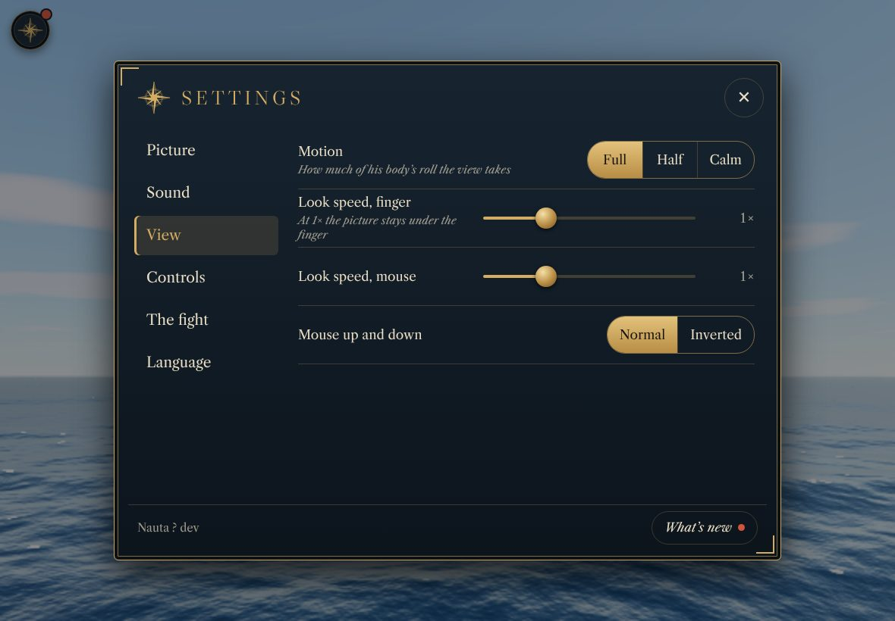
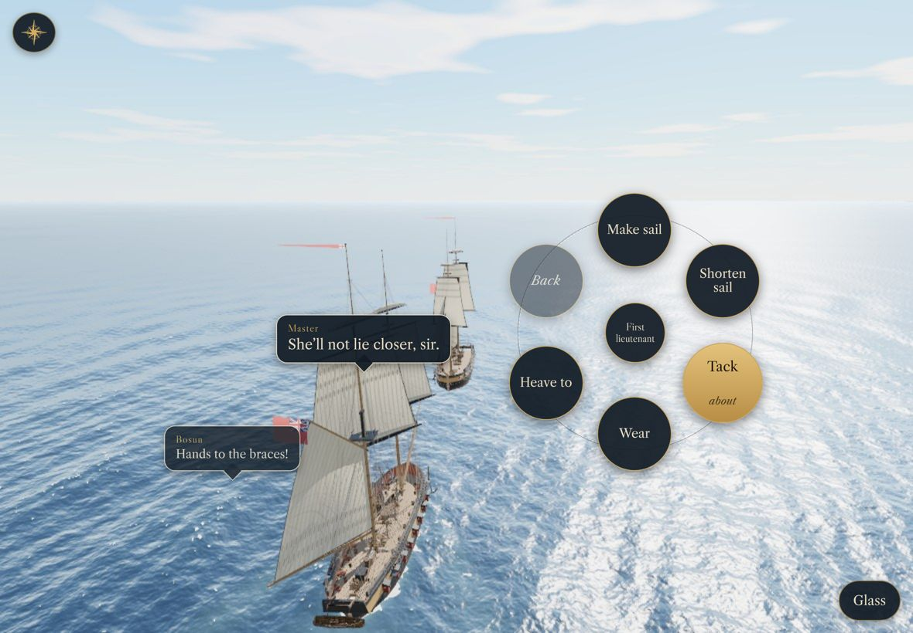

# The interface's look: brass and lacquer

One look for everything that is not the world: the settings, the title and the menus (N7.2, N7.7), the order fan (N4.4), the speech bubbles (N4.5), what's new, the rooms. Written 2026-11-18 with N7.3, the settings (plan N7.0). The CSS is `src/ui/nauta.css`, and every panel over the view opens in the one frame `src/app/sheet.ts#openSheet`.

## The idea

Everything that is not the world looks like the captain's instruments: the binnacle, the sextant's case, the chronometer's box. Black-blue lacquer, brass rules and brass corners, ivory words in the type of 1800, polished brass for what is chosen. It is quiet: dark panels over a bright sea, readable at night, and nothing glows, nothing is glass, nothing moves while the view runs.

Three looks were drawn on 2026-11-18 (`/mnt/project-files/nauta/ui-style/`): A, the Admiralty chart (paper and ink); B, brass and lacquer; C, the signal book (code flags). **Arnd chose B** (2026-11-18).

## Tokens

Every colour and size is a variable on `:root` in `nauta.css`; nothing else names a colour.

| Token | Value | What |
| --- | --- | --- |
| `--lacquer-bg` | `#172430` to `#0c141c`, top to foot | the ground of every sheet |
| `--lacquer-over` | `#121c26ee` | a tag on the view: lacquer, nearly opaque |
| `--lacquer-deep` | `#0a1118` | the groove inside a brass rule, a key's face, a field to type in |
| `--ivory`, `--ivory-soft` | `#eadfc6`, at 65 % | words; help lines and values |
| `--brass`, `--brass-line` | `#d4ad62`, `#c9a45c` | titles, the page shown, rules and corners |
| `--brass-dim`, `--brass-faint`, `--brass-soft` | brass at 60 %, 25 %, 15 % | a control's rule; hairlines and the unslid part of a slider; the page shown's ground |
| `--brass-fill` | `#e3c27c` to `#b88d45` | polished brass: the chosen choice, the order under the finger |
| `--brass-ball` | a lit brass sphere | a slider's knob, the walking thumb's knob |
| `--signal` | `#d0533c` | a version not yet seen; a cry in danger |
| `--target`, `--target-small` | 52 px, 44 px | the least a finger is asked to hit |

## Type

- **Titles**: Libre Caslon Display (`--title-font`) in spaced capitals (0.18 to 0.22 em), brass on a sheet's head, ivory-soft for sections. Only titles and section heads.
- **Words**: Libre Caslon Text (`--word-font`), regular, italic and bold. Caslon was the English book face of 1800. Body 17 px on a sheet, 16 px on the order panel, help lines 14 to 15 px italic. Numbers are old-style in running text and tabular where they change (`.nt-value`).
- Both are SIL Open Font License, served from `public/fonts/` with their licences (about 100 KB together). Georgia stands in until they load.

## The sheet

Every panel that is not the world: a lacquered sheet over the dimmed view, centred, at most the screen less 16 px a side (and the safe areas).

- **The frame**: a 1 px brass rule, a lacquer groove, a second, dimmer brass hairline inside; brass corner pieces at the top left and the foot right, as on a sea chest.
- **The head**: the brass compass rose (44 px), the title in brass capitals, the close button (52 px round, a faint brass ring) at the right.
- **Closing**: the ✕, a tap beside the sheet, or Escape (the sheet on top only).
- **Sections** inside a sheet: spaced capitals between two brass hairlines.
- **Rows**: a setting's name, with an italic help line under it, on the left; its control on the right; a brass hairline under each. On a narrow screen the control goes under the name.

## Controls

| Control | How it looks | Where |
| --- | --- | --- |
| A choice of a few (`.nt-choice`) | one line of words in a rounded brass rule; the chosen one polished brass with dark words | quality, motion, violence, language |
| A slider (`.nt-range`) | a thin brass rule, polished where slid; a brass ball to hold, 28 px | sound levels, look speeds, match length |
| A key cap (`.nt-key`) | a lacquer key in a brass rule, its lower edge heavier; waiting for a key, brass italic | the keys |
| A button in words (`.nt-button`) | a rounded brass rule round the words | the rooms |
| A link-like button (`.nt-link`) | a faint rounded rule, italic | what's new, keys as they were |
| An index of pages (`.nt-tab`) | words; the page shown in brass on a brass-tinted ground with a brass edge | the settings |
| A tag on the view (`.nt-pill`) | lacquer in a brass rule with an inner groove and hairline, a soft shadow; round when it holds a mark | the rose, the glass, the rooms, the standpoints |

## On the view, in play

The fight is watched, not read (design thread, 2026-11-18): **nothing stays on the view but the compass rose** in the top left corner, the way to the settings and the menus. A version not yet seen puts a red dot on it. The version and what's new moved off the view into the foot of the settings. Everything else on the view is there only while it is used, or only where `orders.md` asks for it:

- the glass's tag (bottom right) while the brig is drawn;
- the order panel (`?sail`), a lacquered working panel, until the order fan replaces it (N4.4);
- the room tag ("Two players") beside the rose, until the menus (N7.2) take it;
- the walking thumb's ring: a brass ring and a brass knob, only while the thumb is down;
- the large "Fire!" while a broadside is held for the captain's word (orders.md): a polished brass tag by the thumb.
- on a desk only (a mouse pointing): a key's small cap (`.nt-cap`, a lacquer key in a brass rule) beside what it does on the fan's tags, Fire!, the glass and the Reports tag; the taken mouse's brass dot in the middle; the man under the mouse named in brass small capitals with "click for his orders" under it.
- the controls card (`src/app/controlsCard.ts`): a sheet, once on a device at its first match, and from the pause and Settings, Controls.

## The order fan (for N4.4)

- At most six orders round the finger, each a **round lacquer tag 96 px across** in a brass rule, on a ring 132 px from the finger; one more ring at most.
- At the hub, the man's rank on a smaller round tag (76 px).
- The order under the finger is polished brass with dark words, a little larger (scale 1.08). An order he cannot do now is the same tag at half strength, its words in italic. The order being carried out carries a brass ring outside its own.
- One or two words; a second line in small italic for a detail ("about").
- The ring itself is a faint hairline, so the fan reads as one thing.

## The officer row (N4.4, Arnd 2026-11-18)

- Along the foot of the view, centred, always on screen: one **lacquer card** (112 px wide at most) per man he commands, in a brass rule, with a round lacquer disc 52 px across holding the man's icon in brass (a wheel, a sail, a gun, a hammer, a spyglass, a sealed letter), his rank in small brass capitals (13 px) and his role in small italic ivory (13 px).
- The card of the fan that is open, or pressed, is polished brass with dark words. A man out of the captain's voice has a dashed disc and "by midshipman" in small capitals. A lesson's card carries the brass ring of the lesson marks.
- No images; the icons are inline strokes in the card's own colour. Under 640 px wide the roles go and the cards sit above the foot's tags.

## Speech bubbles (for N4.5)

- A lacquer note in a brass rule, rounded, with a tail to the man. The man's rank above the words in small brass capitals (13 px); the words in ivory Caslon, 18 px.
- A far speaker's bubble is smaller (15 px words) and slightly faded, never smaller than that.
- A cry in danger: the same note in a `--signal` rule, the words bold.
- At most four on the view (orders.md).

## Cost (the interface's share of the 2 ms with sky and light)

- **No backdrop blur anywhere.** Blurring the view under a panel costs a pass over the screen every frame on the iPad; the tags are nearly opaque lacquer instead.
- No images: gradients and rules only. No CSS animation or transition runs while the view does; a panel's words change at most four times a second (`PANEL_EVERY_MS`).
- A sheet opens over the running view and the match goes on (no pause, orders.md).
- Fonts load once with the page, and the service worker keeps them (N7.6).

## Words

The interface's words are in `src/app/words.ts`, in English and German, chosen in the settings (the browser's language at first). Every word a panel shows comes from there; a new panel adds its words in both languages. The orders' words and the bubbles' phrases come with N4.4 and N4.5 (the phrase book), which add theirs to the same place.
